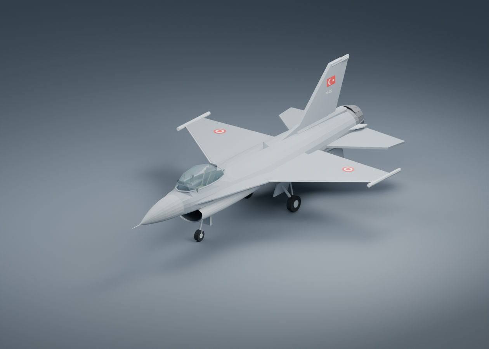
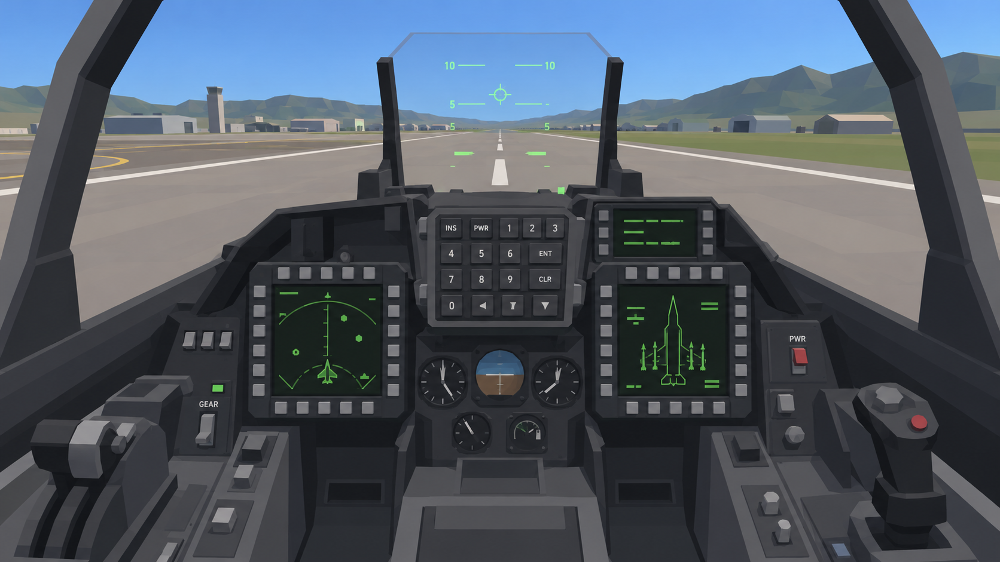

# F-16 Projesi

Gerçek ölçekte, tek koltuklu F-16C Block 52 için Blender modelleme ve sonraki masaüstü oyun aşamasının hazırlık projesi.

Görsel hedef VTOL VR tarzında sade, düşük poligonlu geometri, düz renkli mat malzemeler ve okunabilir kokpit. Intel Iris Xe üzerinde rahat oynanabilirlik öncelikli. Türk Hava Kuvvetleri boyaması kullanıcıya özel bir yorumdur.

## Mevcut durum

Blender ana model aşamasına geçildi. Düzenlenebilir ilk 3D model, yeniden üretim betiği ve altı kamera önizlemesi mevcut. Kokpit ana hacim düzeyindedir; kesin Block 52 ölçüleri, mekanizmalar ve nihai düğmeler hâlâ doğrulanacak. Oyun kodu henüz oluşturulmadı.

## Blender modeli

[F-16C ana model v04](output/model/f16c_block52_main_v04.blend) dosyasını Blender 5.2'de açın. Gövde, kanatlar, kuyruk, hava alığı, nozul, kanopi, iniş takımı, boş pilonlar ve kokpit ana hacimleri ayrı nesneler olarak düzenlenebilir.

- [Pilot bakışı](output/previews/f16_v04_cockpit.png)
- [Üst görünüş](output/previews/f16_v04_top.png)
- [Yan görünüş](output/previews/f16_v04_side.png)
- [Ön görünüş](output/previews/f16_v04_front.png)
- [Ön birleşimler yakından](output/previews/f16_v04_forward_join.png)
- [Üretim betiği](scripts/build_f16.py), [kullanım ve doğrulama sınırları](output/model/MODEL_NOTES.md)

Sahne 1 birim = 1 metre kullanır. Boyut girdileri henüz kesin Block 52 teknik verisi değildir; fiziksel kokpit konumları tahmindir. Çalışan cold start veya uçuş sistemleri bulunmaz.

## Proje dosyaları

- [PLAN.md](PLAN.md): kapsam, tercihler, teslimatlar ve kabul ölçütleri.
- [research/README.md](research/README.md): proje bağlamı ve devam yönergeleri.
- [research/DURUM.md](research/DURUM.md): tamamlanan işler ve sonraki adım.
- [research/ARASTIRMA.md](research/ARASTIRMA.md): teknik bulgular ve kaynaklar.
- [research/TODO.md](research/TODO.md): açık araştırma soruları.
- [research/references/](research/references/): kaynak belgeler ve görseller; indirme adresleri [download_log.json](research/references/download_log.json) içinde.
- [output/concepts/](output/concepts/): üretilen konsept görselleri ve istemleri.

## Konsept

Bu görsel hedeflenen sanat yaklaşımını gösterir; ölçüler, panel yerleşimleri ve GPU performansı için doğrulama değildir.

## Devam etmek

Depoyu klonladıktan sonra önce `AGENTS.md`, `PLAN.md` ve `research/DURUM.md` dosyalarını okuyun. Ana modelde kullanılan geçici ölçüleri ve kokpit tahminlerini kesinleştirmek için Block 52 kaynaklarını doğrulayın. Oyun motoru ve export biçimi sonraki aşamada seçilecek.

Araştırma klasöründeki üçüncü taraf belgeler ve görsellerin hakları ilgili sahiplerine aittir; depoda bulunmaları yeniden kullanım izni sağlamaz.
